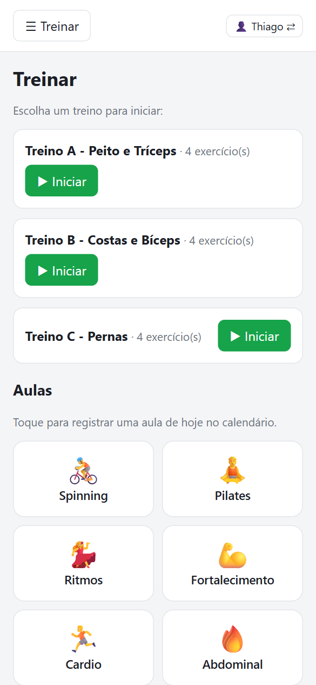
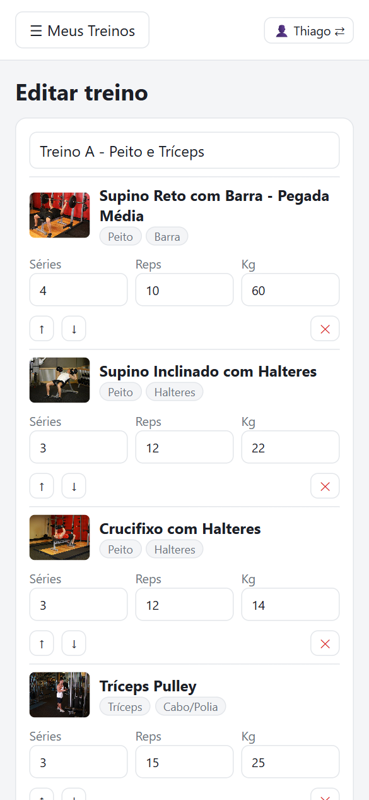
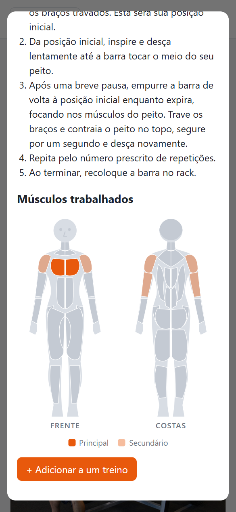
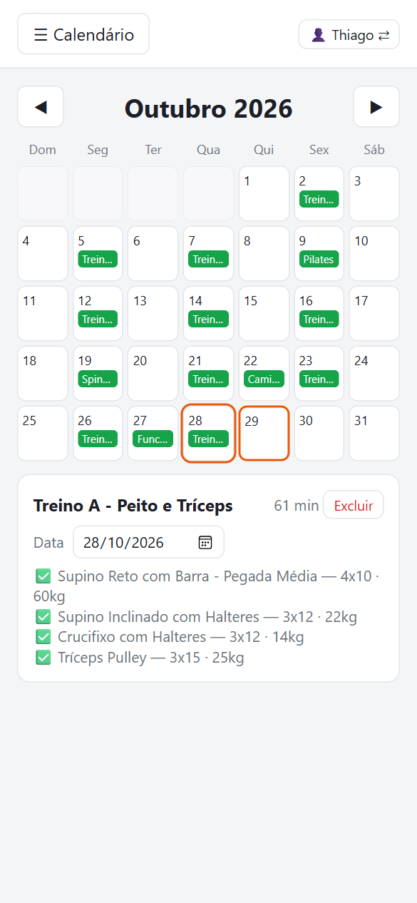

# 🏋️ Meu Treino

[](https://github.com/Thjsantos/MeuTreino/actions/workflows/testes.yml)
[](LICENSE)

App web para **montar treinos de academia, executá-los e registrar no calendário**, pensado para usar no celular durante o treino. Feito para poucas pessoas (os usuários são fixos, sem cadastro), com os dados guardados num banco SQLite/Turso fora do código.

<table>
  <tr>
    <td align="center"><br><sub><b>Treinar</b><br>treinos e aulas</sub></td>
    <td align="center"><br><sub><b>Montar o treino</b><br>séries, reps e carga</sub></td>
    <td align="center"><br><sub><b>Exercício</b><br>execução e músculos</sub></td>
    <td align="center"><br><sub><b>Calendário</b><br>histórico e datas</sub></td>
  </tr>
</table>

## ✨ O que o app faz

- **Banco de 876 exercícios em português**, cada um com fotos dos passos, instruções e filtros por músculo e equipamento.
- **Corpo humano (frente e costas)** em cada exercício, com o músculo principal e os secundários destacados.
- **Treinos montados por você**: escolha exercícios do banco, defina séries, repetições e carga, e reordene.
- **Treinar**: inicie um treino e marque cada exercício como concluído. O treino em andamento fica salvo e continua se você fechar o app.
- **Aulas com um toque**: Spinning, Pilates, Ritmos, Fortalecimento, Cardio, Abdominal, Caminhada e Funcional vão direto para o calendário de hoje, sem duração.
- **Calendário** com tudo o que você fez em cada dia. A data de cada registro pode ser corrigida, para quando você treinou e esqueceu de registrar.
- **Um usuário por pessoa** (por padrão Thiago e Carla), cada um com treinos, execuções e calendário separados.
- **Senha de acesso opcional**, tema claro e escuro, e pode ser instalado na tela inicial do celular.
- **API REST documentada** com Swagger UI em `/docs`.

## 🚀 Como rodar

Requer **Node.js 20 ou superior**.

```bash
npm install
npm start
```

Abra http://localhost:3000. No Windows, também dá para dar dois cliques em `iniciar.bat`.

Sem nenhuma configuração, o app usa um banco SQLite local em `~/MeuTreinoDados/treino.db`, **fora da pasta do projeto**, e não pede senha.

## ⚙️ Configuração

Tudo é feito por variáveis de ambiente, todas opcionais:

| Variável | Para quê | Padrão |
|---|---|---|
| `USERS` | Nomes dos usuários, separados por vírgula (ex.: `Ana,Bruno`) | `Thiago,Carla` |
| `APP_PASSWORD` | Senha de acesso ao app e à API. Sem ela, o acesso é livre | sem senha |
| `PORT` | Porta do servidor | `3000` |
| `MEUTREINO_DB` | Caminho do arquivo SQLite local | `~/MeuTreinoDados/treino.db` |
| `TURSO_DATABASE_URL` | URL do banco [Turso](https://turso.tech) (`libsql://...`). Se definida, substitui o SQLite local | — |
| `TURSO_AUTH_TOKEN` | Token do banco Turso | — |

```bash
USERS="Ana,Bruno" APP_PASSWORD="segredo" npm start        # Linux/macOS
$env:USERS="Ana,Bruno"; $env:APP_PASSWORD="segredo"; npm start   # PowerShell
```

> **Sobre `USERS`:** a lista só **adiciona** usuários. Tirar um nome dela não apaga o usuário nem os dados dele, e ele continua aparecendo na tela inicial. Nomes repetidos (sem diferenciar maiúsculas) são ignorados e cada nome pode ter até 50 caracteres.

## ☁️ Publicar (Render + Turso)

Para acessar do celular fora de casa, o app precisa estar na internet com um banco que não dependa do disco do servidor. A combinação gratuita usada aqui:

1. **Turso**: crie um banco e gere a URL (`libsql://...`) e um token **do banco**.
2. **Render**: crie um *Blueprint* a partir deste repositório. Ele lê o [`render.yaml`](render.yaml) e pede as variáveis `TURSO_DATABASE_URL`, `TURSO_AUTH_TOKEN` e `APP_PASSWORD`. Opcionalmente, crie também `USERS`.
3. A cada merge na `main`, o Render publica sozinho.

Nunca coloque tokens ou senhas em arquivos do repositório: elas ficam só nas variáveis do Render. No plano gratuito do Render o serviço "dorme" quando fica parado, e o primeiro acesso depois disso leva uns 30 segundos.

## 📚 API

A documentação interativa (Swagger UI) fica em **`/docs`**, gerada a partir de [`public/openapi.yaml`](public/openapi.yaml). Todas as rotas, exceto o login, exigem o cookie de acesso quando há senha.

| Recurso | Rotas (`/api/...`) |
|---|---|
| Login | `POST /login` |
| Usuários | `GET /users` |
| Treinos | `GET`/`POST /users/:uid/routines`, `GET`/`PUT`/`DELETE /users/:uid/routines/:rid` |
| Registros do calendário | `GET /users/:uid/logs?month=AAAA-MM`, `POST /users/:uid/logs`, `GET`/`PUT`/`DELETE /users/:uid/logs/:lid` |
| Treino em andamento | `GET`/`PUT`/`DELETE /users/:uid/session` |

Erros sempre voltam como `{ "erro": "mensagem" }`.

## 🧪 Testes e CI

```bash
npm test
```

São testes automáticos da API (com um banco temporário), da base de exercícios, do desenho do corpo, da lista de usuários e do gerador de relatório. Os testes do navegador não estão no repositório.

O pipeline [`Testes`](.github/workflows/testes.yml) roda no GitHub Actions em todo PR para a `main` e em cada push nela: instala as dependências, roda os testes e valida o `openapi.yaml`. Cada execução publica:

- um **relatório em HTML** (artefato `relatorio-testes.html`) com status, totais, tempo de cada teste, erros e filtros;
- o mesmo resultado em Markdown na aba **Summary** da execução;
- os dados em XML (JUnit) e JSON.

## 🗂️ Estrutura do projeto

```
├── server.js              ponto de entrada: abre o banco e sobe o servidor
├── iniciar.bat            atalho para rodar no Windows
├── render.yaml            configuração do deploy no Render
├── public/                tudo o que o navegador recebe
│   ├── index.html, app.js, corpo.js, style.css   o app
│   ├── icon.svg, manifest.webmanifest            ícone e instalação no celular
│   ├── docs.html, openapi.yaml                   documentação da API (/docs)
│   └── dados/             base de exercícios (exercises.js) e tradução (exercises_pt.js)
├── src/                   o servidor
│   ├── http.js            servidor HTTP, senha e arquivos estáticos
│   ├── routes.js          rotas da API
│   ├── validate.js        validação dos dados recebidos
│   ├── repo.js            acesso ao banco (SQL)
│   └── users.js, errors.js
├── test/                  testes automáticos
├── scripts/               gerar a tradução, validar o OpenAPI e montar o relatório de testes
├── docs/img/              capturas de tela deste README
└── .github/workflows/     pipeline de testes
```

## 🤝 Contribuindo

A `main` é protegida: não aceita push direto, e o merge só é liberado com o check **"Testes (API e exercícios)"** verde. O fluxo é criar uma branch, abrir um PR e aguardar os testes.

## 📄 Licença

O código deste projeto está sob a licença [MIT](LICENSE): você pode usar, copiar, modificar e distribuir, desde que mantenha o aviso de copyright. A base de exercícios, as imagens e a tradução são de terceiros e seguem as licenças de cada projeto, citadas abaixo.

## 📦 Dados e créditos

- **Exercícios e imagens**: [free-exercise-db](https://github.com/yuhonas/free-exercise-db) (domínio público). As fotos são carregadas diretamente de lá, então é preciso estar online para vê-las.
- **Tradução para português**: [exercicios-bd-ptbr](https://github.com/joao-gugel/exercicios-bd-ptbr) (CC0). O arquivo `public/dados/exercises_pt.js` é gerado por `node scripts/gerar-exercicios-pt.js`, fixado em um commit específico da tradução.
- **Corpo humano**: desenho SVG próprio e simplificado (`public/corpo.js`), sem imagens de terceiros.
- As capturas de tela deste README usam dados de demonstração.
